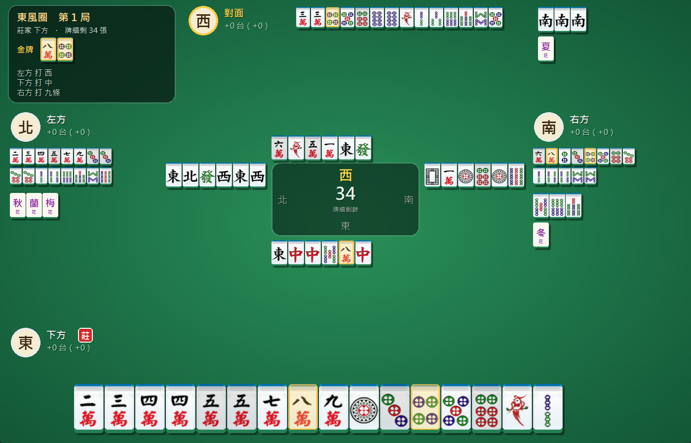
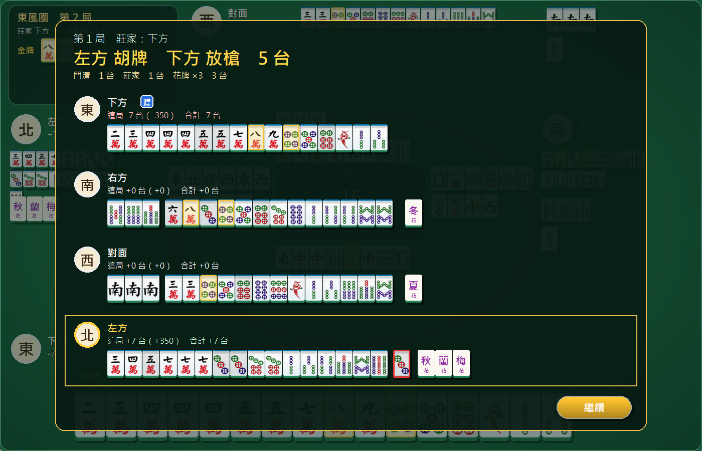
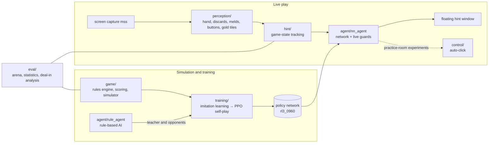

# Taiwanese 16-tile Mahjong AI: Reinforcement Learning × Computer Vision

[中文](README.md) | **English**

[](https://github.com/TedChu021333/taiwan-mahjong-ai/actions/workflows/tests.yml)

[](LICENSE)

A Taiwanese 16-tile mahjong AI built from scratch. I wrote my own rules engine and simulator, trained a policy
network with imitation learning followed by reinforcement learning (PPO self-play), and connected it to a
real-time computer-vision pipeline that reads the screen of the Taiwanese mobile mahjong game 明星三缺一
(run on PC through Google Play Games) and suggests moves on its "classic" table.

> **Research use.** This is a personal project for learning reinforcement learning and computer vision.
> At tables with human players the program only gives hints (the AI suggests, a person clicks).
> Automatic clicking was only tried in practice rooms where all three opponents are the game's own bots,
> and the program contains no detection-evasion features of any kind. Automating the game may violate its
> terms of service; do not use it against human players. Game graphics are not included in this repository.

Code comments and commit messages are in Traditional Chinese; this page describes the design in English.

| Four AIs playing each other (watch mode, all hands open) | End-of-hand settlement: scoring breakdown and all four hands |
|---|---|
|  |  |

## Results

| Item | Result |
|---|---|
| RL network vs rule-based AI (simulator, 4,000 paired games each) | **+0.33 ± 0.29 tai per game**; deal-in rate 18.9% → 17.4% |
| Live play, Oct 28 – Nov 2 (2,155 games vs the game's bots) | Win rate **26%** (bots average about 24%); deal-in rate about 16% |
| Live play, total on the settlement screens | **+128,815** coins (about −114,000 after the game's 15% cut of winnings; see Conclusions) |
| Screen reading of my own discards | **99.5%** correct (9 errors in 1,658 tiles) |
| Code size | About 20,000 lines of Python, 448 pytest tests |

*Tai* is the scoring unit of Taiwanese mahjong: harder hands earn more tai, and payments scale with them.
A *deal-in* means discarding the tile another player wins on, which makes you pay for their hand.

## Architecture



## Modules

| Directory | Contents |
|---|---|
| `game/` | Tile encoding, win detection, rules state machine, scoring (calibrated item by item against 1,851 settlement screens), hand and full-round simulator |
| `agent/` | Shanten (tiles-from-ready) and effective tiles, rule-based AI, expected-value AI, Monte Carlo AI, opponent tenpai/deal-in model, policy network with live guards |
| `training/` | Action encoding (108 actions), state encoding (60 planes × 34 tile types), residual CNN, teacher data generation, supervised learning, PPO |
| `perception/` | Template matching for the hand, discard tracking, opponent melds (read after perspective correction), buttons, gold tiles, dealer, ready declarations |
| `hint/` | Hint-mode main loop: merges each frame's readings, infers chow/pung/kong, decides, logs, draws the floating windows |
| `control/` | Turns decisions into clicks (practice-room experiments only) and manages the game window |
| `eval/` | Paired policy comparison (arena), statistics from settlement screenshots, per-deal-in analysis and calibration of the deal-in estimates |
| `play/` | My own Tk table: you vs three AIs, or watch four AIs; every hand is logged and compared with the AI's choices for review |
| `tests/` | pytest tests for every module |

## Method

### 1. Rules engine and simulator
- Full Taiwanese 16-tile rules: chow/pung/kong (including robbing the kong), flowers (all eight flowers, seven-robs-one),
  dealer repeats and their bonus, concealed self-draw, all-sequences hand, single wait, big/small three dragons,
  big/small four winds, and so on, plus this game's own features: gold tiles (bonus tiles drawn each hand),
  the three-tile exchange at the start, and declaring ready.
- The tai table was calibrated against the game: I read the scoring breakdown of 1,851 settlement screens and fixed
  the all-sequences and wind-pung items where they disagreed.
- The shanten calculation splits the hand into characters, dots, bamboo and honors, solves each suit separately and
  merges the results. It matches the original tile-by-tile recursion on 20,000 random hands and cut one simulated
  game from 1.9 s to 0.13 s, which made large-scale self-play feasible.

### 2. Rule-based AI (teacher and baseline)
- Picks discards by shanten, effective tiles and shape (effective tiles one step further ahead); defends with
  safe tiles, suji and opponents' ready declarations.
- The three-tile exchange is chosen one tile at a time, sampling the replacement tiles to estimate the expected shanten.

### 3. Learned AI
1. **Imitation learning.** Four rule-based AIs played 60,000 games, giving 2.8 million decisions. The network
   matched the teacher's choice 88.7% of the time and played at the teacher's level.
2. **Reinforcement learning (PPO).** Starting from the imitation network, it plays against itself. The reward is
   each game's actual result after the game's cut; the advantage subtracts the value head's prediction to remove
   most of the luck. Games run in parallel with batched GPU inference, about 60 games per second.
   Each seat is randomly replaced by the rule-based AI or an earlier version of the network (an opponent pool),
   so the network does not just learn to beat itself.
3. After 10 hours and 964 iterations (about 2 million games), `rl3_0960` became the first AI to beat the
   rule-based AI **significantly** in the simulator. Most of the gain is in defense (fewer deal-ins).

Network: 60 × 34 input planes, a 10-block 1D residual CNN with 128 channels (about 2.1 million parameters),
a policy head over 108 actions and a value head (expected tai). The input contains only what that player can see,
plus noise that imitates live screen-reading errors (missed discards, unknown meld contents, missed declarations),
so the network trained in the simulator can be used on the real game directly.

### 4. Live guards
Where the network's simulator habits meet unusual live situations, a few explainable rules check its choice;
every override is written to the log:
- **Deal-in check.** When an opponent has declared ready, the opponent model estimates the deal-in probability of
  every tile. The network's tile is replaced by a safer one only if the deal-in cost saved exceeds the attacking
  value lost. Validated on 9,094 live discards: 115.8 deal-ins estimated, 109 actual.
- **Efficiency checks.** Keep a ready hand, prefer clearly more effective tiles and better shapes, go for a
  one-suit hand when it is close, and pung honor tiles that add tai.

### 5. Screen reading
- The game runs at a fixed 1920×1080. The hand, the enlarged claimable tile and the gold tiles are read by
  template matching at 40×60 resolution, about 0.1 s per frame.
- Discards are tracked by position: a new tile must appear in 3 consecutive frames, and the tracker tells
  "taken by a chow/pung" apart from "briefly hidden by an animation".
- Opponents' melds are seen from the side, in perspective. Each row is straightened using four marked corners and
  matched with rotated templates; the chow/pung inferred from the discards guides the search, and stacked kongs and
  face-down concealed kongs are detected separately.
- Settlement screens: amounts, all four hands, the scoring breakdown and the coin balance, used for statistics and
  for measuring the game's cut of winnings.

## Experiments that did not work

| Attempt | Result and reason |
|---|---|
| Entropy bonus in PPO | Entropy 0.3 → 1.0 and win rate 23% → 17%: the bonus drowned the very noisy win/loss signal. Removed, and an automatic stop was added |
| 1.7 million more training games (rl7) | No improvement, only more cautious play |
| Playing each deal twice as a baseline; an "oracle" value network that sees every hand | One game's result has a standard deviation of about 7.5 tai; even the oracle explained only about 2% of it. Good and bad play differ by only 0.1–0.3 tai per game, so baseline-style variance reduction did not help |
| Expert iteration with rule-based rollouts as the teacher | Over 3,200 positions the rollouts could not see where the network was better; at best they teach back to the rule-based level |
| Expert iteration with the network's own rollouts | With 200 rollouts per candidate, label noise (about 0.6 tai) exceeded the true differences (about 0.4 tai); fine-tuning learned nothing that generalized |
| Searching with rollouts during live play | Theoretical ceiling about +0.3 tai per game; no visible difference in practice, so it was removed |

## Conclusions
- The AI significantly beats the rule-based AI in the simulator, wins more often than the game's own bots in live
  play, and is ahead on the settlement screens.
- The game takes 15% of every hand's winnings (measured hand by hand from the coin balance: 242 wins, 15% at every
  venue). To break even, winnings must be 1.18 times losses; the AI is at about 1.09, so the cut is larger than its edge.
- Mahjong is extremely noisy: one game's result varies by about 7.5 tai while differences in play are a few tenths
  of a tai per game, so confirming a +0.2 tai improvement takes about 6,000 paired games.

## Installation and usage

### 1. Install (Windows)
1. Install [Python 3.12](https://www.python.org/downloads/) and tick **Add python.exe to PATH** in the installer.
2. Download this repository (green **Code** button → **Download ZIP**) and unzip it.
3. Double-click **`install.bat`**. It creates a virtual environment and installs everything
   (the GPU build of PyTorch if an NVIDIA card is present).
4. Double-click **`start.bat`** to open the menu:

| Option | What it does | Needs the game |
|---|---|---|
| 1 | Auto mode (only in practice rooms where all opponents are bots) | Yes |
| 2 | Today's statistics (from settlement screenshots) | Yes |
| 3 | You vs three AIs, one full round | No |
| 4 | Four AIs play each other with all hands open (watch) | No |

The trained model `models/rl3_0960.pt` (about 8.6 MB) is included, so you can play against the AI right away.
To play against the rule-based AI instead: `.venv-train\Scripts\python -m play --bot rule`.

### 2. Set up the game (only for hint and auto modes)
1. Install [Google Play Games for PC](https://play.google.com/googleplaygames) (Google's official Android game emulator).
2. Search for and install **明星3缺1** inside it.
3. Set the screen to **1920×1080**, run the game **full screen**, and join a table on the green **classic** layout (one full round).
4. Screen reading needs reference images in `train/`. They are screenshots of the game, so they are **not included**;
   build them from your own screenshots:

   | Folder / file | Purpose | How to build |
   |---|---|---|
   | `train/templates/` | The 34 hand tiles | `python -m perception.extract_templates <screenshot> <hand from left to right>` |
   | `train/buttons/` | Continue and settlement buttons; opponents' ready marker; dealer-repeat digits | Buttons: `python -m perception.continue_button <screenshot> <name>`; markers and digits cropped by hand |
   | `train/river_templates/` | Discarded tiles | `python -m perception.river_reader <screenshot> --label ...`; also collected automatically during play |
   | `train/settlement_templates/`, `train/meld_templates/` | Settlement hands, opponents' melds | Collected automatically during play |
   | `eval/my_name.png` | Your own name on the settlement screen (for statistics) | Cropped from a settlement screenshot |

5. Hint mode: `.venv-train\Scripts\python -m hint --ai nn`. A floating window shows the suggestion (drag to move,
   right-click to close). Press **Esc** to stop after the current round, again to stop immediately; in auto mode,
   moving the mouse to the **top-left corner** of the screen aborts at once.

### 3. Other commands

```bash
# You vs three AIs (--bot rule for the rule-based AI); --watch for four AIs with open hands
python -m play --model models/rl3_0960.pt
python -m play --model models/rl3_0960.pt --watch

# Training: teacher data → imitation learning → PPO (NVIDIA GPU needed; the author used an RTX 5060)
python -m training.teacher_data --games 60000 --workers 2      # about 1 hour
python -m training.supervised --out models/sl_rule.pt         # about 10 minutes
python -m training.selfplay --init models/sl_rule.pt --out models/rl.pt --actors 8 --hours 10

# Paired comparison of two policies
python -m eval.arena --variant nn:models/rl.pt --baseline rule --games 2000 --workers 4

# Tests
python -m pytest tests
```

Run these with the python in `.venv-train\Scripts\`. The screen templates (`train/`) are not in the repository;
without them the `play/` table draws tile faces as text. On a fresh clone the test suite gives 399 passed and
49 skipped (the skipped tests need game screenshots from `train/`). `launcher.pyw` is a button version of the menu
that can be used as a desktop shortcut.

## Author
朱泰翰 (GitHub: [TedChu021333](https://github.com/TedChu021333)), Department of Computer Science and Information
Engineering, National Taiwan University of Science and Technology.

## License
The code is released under the [MIT License](LICENSE). The name, graphics and assets of 明星三缺一 belong to
their copyright holders and are not covered by this license.
