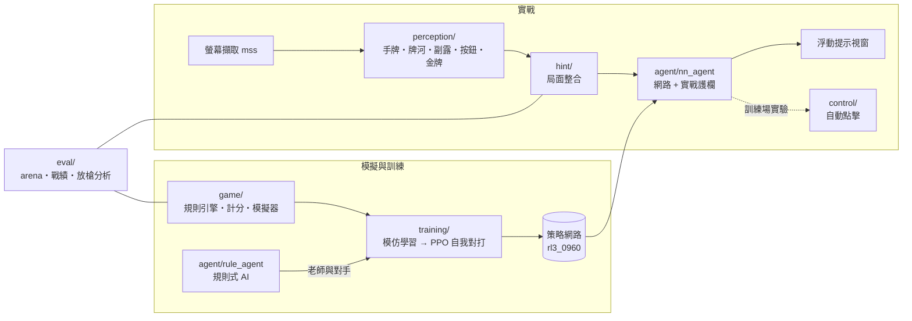

# 台灣 16 張麻將 AI

從零打造的台灣 16 張麻將 AI：自己寫規則引擎與模擬器，用模仿學習加強化學習（PPO 自我對打）訓練出策略網路，
再用電腦視覺即時讀取遊戲畫面，在手機遊戲「明星三缺一」（電腦上用 Google Play Games 執行）的經典版牌桌上給出打牌建議。

> 研究用途說明：本專題是學習強化學習與電腦視覺的個人研究。與真人對戰的牌桌只使用「提示模式」
> （AI 建議、人自己點）；自動點擊只在對手全是電腦的訓練場做過實驗，程式沒有任何規避偵測的設計。
> 自動操作可能違反遊戲服務條款，請勿用於真人對局。遊戲畫面素材與模型權重不包含在本 repo 中。

## 成果摘要

| 項目 | 結果 |
|---|---|
| 強化學習網路 vs 規則式 AI（模擬器，各 4000 對同牌配對） | **+0.33 ± 0.29 台／局**，放槍率 18.9% → 17.4% |
| 實戰 10/28～11/2（對手是遊戲內電腦，2155 局） | 胡牌率 **26%**（三家電腦平均約 24%）、放槍率約 16% |
| 實戰結算畫面金額合計 | **+128,815**（扣掉遊戲對贏家抽的 15% 後約 −114,000，見「結論」） |
| 自己出牌的畫面辨識 | 讀對 **99.5%**（1658 張中讀錯 9 張） |
| 程式規模 | Python 約 2 萬行、448 個 pytest 測試 |

## 系統架構



## 模組說明

| 目錄 | 內容 |
|---|---|
| `game/` | 牌編碼、胡牌判定、規則狀態機、計分（依 1851 張結算畫面逐項校正台數）、一局／一圈模擬器 |
| `agent/` | 向聽數與有效進張、規則式 AI、期望值 AI、蒙地卡羅 AI、對手聽牌與放槍機率模型、策略網路與實戰護欄 |
| `training/` | 動作編碼（108 種）、局面編碼（60 個 34 格平面）、殘差卷積網路、老師資料產生、監督學習、PPO |
| `perception/` | 模板比對辨識手牌、牌河追蹤、對手副露（透視拉直後比對）、按鈕、金牌、莊家、宣告聽牌 |
| `hint/` | 提示模式主迴圈：整合每一幀的辨識結果、推算吃碰槓、決定、記錄、浮動小視窗 |
| `control/` | 把決定轉成點擊（僅訓練場實驗用）、遊戲視窗管理 |
| `eval/` | 策略配對比較（arena）、讀結算截圖統計戰績、逐次放槍分析與放槍估計校準 |
| `play/` | 自己的 Tk 牌桌：人 vs 三家 AI、四家 AI 觀戰，每局記錄並和 AI 的選擇比對復盤 |
| `tests/` | 每個模組的 pytest 測試 |

## 方法

### 1. 規則引擎與模擬器
- 完整實作台灣 16 張規則：吃碰槓（含搶槓）、花牌（八仙過海、七搶一）、連莊拉莊、門清自摸、平胡、獨聽、
  大小三元、大小四喜等，以及這款遊戲特有的金牌、換三張、按聽宣告。
- 台數表用實戰結算畫面校正：讀了 1851 張結算的台數明細，逐項比對後修正平胡與風刻的計算。
- 向聽數改成萬、筒、條、字四組分開拆再合併，和原本逐張遞迴的版本隨機 2 萬手全部一致，
  模擬一局從 1.9 秒加速到 0.13 秒，讓大量自我對打變得可行。

### 2. 規則式 AI（老師與基準）
- 以向聽數、有效進張、牌型（往後多看一步的進張）挑牌；防守用現物、筋牌與對手宣告資訊。
- 換三張逐張挑選，以抽樣估計換回牌後的期望向聽數。

### 3. 學習型 AI
1. **模仿學習**：規則式 AI 四家互打 6 萬局、280 萬個決定，網路學到與老師一致 88.7%，實力與老師打平。
2. **強化學習（PPO）**：從模仿學習的網路出發自我對打，獎勵是每局扣抽成後的實際輸贏，
   優勢函數以價值頭預測扣掉運氣成分；GPU 批次推論、多程序同時打約 60 局／秒。
   每局座位隨機換成規則式 AI 或過去版本的自己（對手池），避免只學會打贏自己。
3. 10 小時、964 輪（約 200 萬局）後的 `rl3_0960` 是第一個在模擬器中**顯著**贏過規則式的 AI，
   進步主要在防守（放槍率下降）。

網路架構：60 × 34 輸入平面、128 寬 10 層 1D 殘差卷積（約 210 萬參數），
策略頭 108 個動作 + 價值頭（輸贏台數）。輸入只用該玩家看得到的資訊，並加入模仿實戰辨識缺陷的雜訊
（牌河漏記、副露看不到、宣告漏認），讓模擬器訓練出的網路能直接用在實戰。

### 4. 實戰護欄
網路在模擬器裡學到的打法，遇到實戰的特殊狀況時由幾條可解釋的規則把關，每次改動都寫進記錄檔：
- **放槍檢查**：有人宣告聽牌時，用對手模型估每張牌的放槍機率，換打較安全的牌要「少付的放槍損失 > 少掉的進攻」才換。
  估計值以 9094 手實戰檢驗：估 115.8 次、實際 109 次。
- **牌效檢查**：保持聽牌、進張明顯較多的牌、牌型較好的牌、做清一色、會加台的字牌碰等。

### 5. 畫面辨識
- 遊戲固定 1920×1080；手牌、放大的可吃碰牌、金牌用模板比對（40×60 解析度，一幀約 0.1 秒）。
- 牌河：以位置追蹤每家出牌，新位置連續 3 幀才算，能分辨「被吃碰拿走」與「暫時被動畫遮住」。
- 對手副露：側面的牌有透視，先依標記的四角拉直成直條，再用轉向的模板滑動比對；
  再用牌河推算的吃碰引導搜尋，並辨識疊起來的槓與牌背朝上的暗槓。
- 結算畫面：讀金額、四家手牌、台數明細與底部金幣餘額，用來統計戰績與驗證抽成。

## 實驗紀錄：沒有成功的嘗試

| 嘗試 | 結果與原因 |
|---|---|
| PPO 加熵獎勵 | 熵 0.3 → 1.0、胡牌率 23% → 17%：雜訊很大的輸贏訊號被熵獎勵蓋過。改成不加熵並加自動煞車 |
| 再練 170 萬局（rl7） | 沒有進步，只學到更保守 |
| 同一副牌打兩次互為基準、全知價值網路 | 一局輸贏標準差約 7.5 台，連全知價值網路只能解釋約 2%；打法好壞每局僅 0.1～0.3 台，基準類降雜訊無效 |
| 規則式模擬當老師（專家迭代） | 3200 個局面的模擬看不出網路比規則式好的地方，最多教回規則式的程度 |
| 網路自己模擬當老師 | 每張候選 200 次模擬的標籤雜訊（約 0.6 台）大於真實差距（約 0.4 台），微調學不到可推廣的東西 |
| 實戰當場模擬挑牌 | 理論上限每局約 +0.3 台，實戰感受不明顯，已移除 |

## 結論
- AI 在模擬器顯著贏過規則式，實戰胡牌率也高過遊戲內的電腦對手，結算畫面金額是正的。
- 但遊戲對每局贏的錢抽 15%（用金幣餘額逐局對出，242 局各種場館都是 15%）。
  要打平，贏的錢必須是輸的 1.18 倍，目前約 1.09 倍——抽成大於 AI 的優勢。
- 麻將的運氣成分極大：每局輸贏標準差約 7.5 台，打法差距每局只有零點幾台，
  要確認 +0.2 台的進步需要約 6000 對配對對局。

## 安裝與執行

### 1. 安裝程式（Windows）
1. 安裝 [Python 3.12](https://www.python.org/downloads/)，安裝畫面記得勾選 **Add python.exe to PATH**。
2. 下載這個 repo（綠色 **Code** 按鈕 → **Download ZIP**，解壓縮）。
3. 雙擊 **`install.bat`**：自動建立虛擬環境、安裝所有套件（有 NVIDIA 顯示卡會裝 GPU 版 PyTorch）。
4. 雙擊 **`start.bat`** 開啟總選單：

| 選項 | 功能 | 需要遊戲 |
|---|---|---|
| 1 | 麻將自動模式（只在對手全是電腦的訓練場使用） | 要 |
| 2 | 今天的戰績（讀結算截圖） | 要 |
| 3 | 自己 vs 三家 AI，打一圈 | 不用 |
| 4 | 四家 AI 互打、手牌全開（觀戰） | 不用 |

選項 3、4 需要模型權重 `models/rl3_0960.pt`（不在 repo 中，見下方「訓練」）；沒有權重時可用
`.venv-train\Scripts\python -m play --bot rule` 和規則式 AI 對打。

### 2. 準備遊戲（提示模式、自動模式才需要）
1. 安裝 [Google Play Games 電腦版](https://play.google.com/googleplaygames)（Google 官方的 Android 遊戲模擬器）。
2. 在裡面搜尋並安裝「**明星3缺1**」。
3. 螢幕解析度設 **1920×1080**，遊戲開**全螢幕**，進入「**經典版**」綠色桌面的牌桌（一圈）。
4. 第一次使用要先建立畫面模板：截幾張自己的牌局畫面，用
   `python -m perception.extract_templates <截圖> <由左到右的手牌>` 產生 34 種牌的模板（存在 `train/`）。
5. 提示模式：`.venv-train\Scripts\python -m hint --ai nn`，畫面上會出現浮動小視窗顯示建議。

### 3. 其他指令（進階）

```bash
# 自己 vs 三家 AI（--bot rule 換規則式 AI）；--watch 四家 AI 互打、手牌全開
python -m play --model models/rl3_0960.pt
python -m play --model models/rl3_0960.pt --watch

# 訓練：老師資料 → 模仿學習 → PPO
python -m training.teacher_data --games 60000 --workers 2
python -m training.supervised --out models/sl_rule.pt
python -m training.selfplay --init models/sl_rule.pt --out models/rl.pt --actors 8

# 兩種策略配對比較
python -m eval.arena --variant nn:models/rl.pt --baseline rule --games 2000 --workers 4

# 測試
python -m pytest tests
```

以上指令都在 `.venv-train\Scripts\` 的 python 下執行。模型權重（`models/`）與畫面模板（`train/`）不在 repo 中；
沒有模板時，`play/` 的牌桌會改用文字畫牌面。

## 作者
朱泰翰．國立臺灣科技大學 資訊工程系
